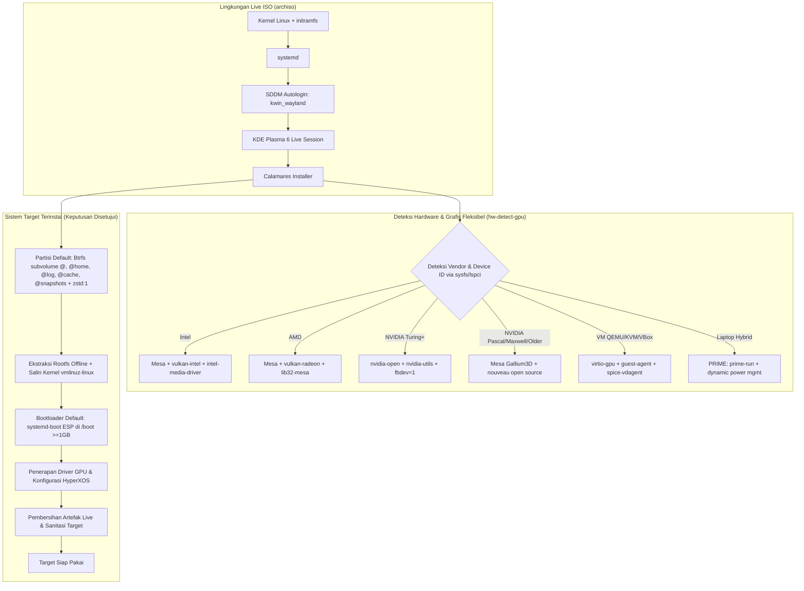
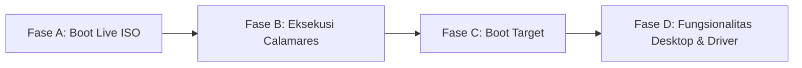

# Rencana Pengembangan HyperXOS

Dokumen ini berisi cetak biru arsitektur, spesifikasi teknis, strategi pengujian, dan rencana kerja komprehensif untuk pengembangan distribusi Linux **HyperXOS**.

---

## 1. Tujuan dan Ruang Lingkup Proyek

### 1.1 Tujuan Proyek
HyperXOS adalah distribusi sistem operasi berbasis **Arch Linux** yang dirancang untuk menghadirkan pengalaman komputasi modern, performa tinggi, dan siap pakai (*out-of-the-box*) untuk pengguna desktop harian, pengembang, maupun gamer. HyperXOS menggabungkan keunggulan model rilis bergulir (*rolling release*) Arch Linux dengan lingkungan desktop **KDE Plasma 6**, kemudahan instalasi grafis melalui **Calamares**, manajemen paket kustom, serta dukungan perangkat keras grafis modern, khususnya modul kernel terbuka NVIDIA (**NVIDIA Open Kernel Modules** / `nvidia-open`).

### 1.2 Ruang Lingkup Proyek
- **Sistem Live (Live ISO):**
  - Media instalasi berbasis UEFI dan BIOS (hybrid ISO).
  - Lingkungan Live grafis langsung masuk (*autologin*) ke sesi KDE Plasma (Wayland) dengan utilitas diagnostik dan launcher installer Calamares.
  - Skrip deteksi otomatis untuk jaringan dan perangkat keras.
- **Sistem Target (Hasil Instalasi):**
  - Instalasi sistem dasar Arch Linux minimalis namun lengkap dengan skema instalasi hybrid (offline base + online optional packages).
  - Desktop Environment KDE Plasma 6 yang terkonfigurasi rapi (tema visual kustom, wallpaper, ikon, font, dan konfigurasi default).
  - Konfigurasi audio modern berbasis PipeWire + WirePlumber.
  - Stack grafis 100% open-source untuk Intel, AMD, dan NVIDIA (`mesa`, Vulkan RADV/ANV, modul terbuka `nvidia-open` pada Turing ke atas, dan stack terbuka `nouveau` untuk Pascal/Maxwell/lawas).
  - Integrasi repositori lokal/khusus HyperXOS di media instalasi dan konfigurasi mirror online resmi berbasis GitHub Releases untuk pembaruan pasca-instalasi.
- **Di Luar Ruang Lingkup (Tahap Awal):**
  - Arsitektur non-x86_64 (seperti ARM64 atau RISC-V).
  - Driver proprietary lawas 470xx/390xx untuk Kepler/Fermi (tidak memiliki dukungan GBM untuk sesi Wayland Plasma 6; kartu lawas ditangani secara stabil via driver open-source `nouveau`).
  - Repositori cloud terdistribusi multi-mirror berskala enterprise (tahap awal menggunakan mirror GitHub Releases + repo lokal ISO).

---

## 2. Arsitektur Sistem dan Teknologi yang Dipilih



### 2.1 Komponen Inti Sistem (Telah Disetujui)
| Komponen | Teknologi Terpilih | Justifikasi Teknis & Status Keputusan |
| :--- | :--- | :--- |
| **Basis Sistem** | Arch Linux (x86_64) | Basis rolling release stabil, repositori mutakhir, dokumentasi luas, kemudahan kustomisasi via `archiso`. |
| **Kernel** | `linux` (Kernel Standar) + `linux-headers` | Kompatibilitas luas, stabilitas tinggi, serta kompatibilitas penuh dengan modul kernel `nvidia-open` dan DKMS. |
| **Init & Service Manager** | `systemd` | Standar defacto Arch Linux, manajemen dependensi layanan terintegrasi, boot cepat, kompatibel penuh dengan Calamares. |
| **Display Server** | Wayland (KWin Wayland) | Kinerja responsif, isolasi keamanan antar-jendela, dukungan multi-refresh rate modern, dan dukungan native pada KDE Plasma 6. |
| **Desktop Environment** | KDE Plasma 6 (`plasma-meta` / komponen modular) | Modern, kaya fitur kustomisasi, hemat sumber daya relatif terhadap GNOME, didukung stack Qt 6 terbaru. |
| **Display Manager** | SDDM (`sddm` dengan backend `kwin_wayland`) | Display manager resmi untuk KDE Plasma, mendukung Wayland session secara native. |
| **Audio Server** | PipeWire (`pipewire`, `wireplumber`, `pipewire-pulse`, `pipewire-alsa`, `pipewire-jack`) | Pengganti modern PulseAudio/JACK dengan latensi rendah, manajemen routing fleksibel, dan kompatibilitas tinggi. |
| **Network Manager** | NetworkManager + backend `iwd` | Koneksi Wi-Fi lebih cepat, hemat baterai, dan stabil; integrasi mulus dengan applet KDE `plasma-nm`. |
| **Browser Web Bawaan** | Firefox (`firefox`) | Browser standar stabil, terisolasi dengan Wayland native rendering. |
| **Installer Grafis** | Calamares (Qt 6) | Framework installer modular open-source standar industri distro independen, disesuaikan via C++ & YAML. |
| **Sistem Berkas Target** | **Btrfs (Default Terpilih - Opsi A)** | Skema subvolume `@` (root), `@home`, `@log`, `@cache`, `@snapshots` dengan kompresi `zstd:1` otomatis. |
| **Bootloader** | **systemd-boot (Default Terpilih - Opsi A)** | Sangat cepat, modern, terintegrasi langsung dengan systemd di UEFI. ESP di-mount di `/boot` (minimal 1024 MiB). Fallback ke GRUB otomatis jika terdeteksi firmware BIOS legacy atau dipilih user. |
| **AUR Helper Bawaan** | **`paru` (Default Terpilih - Opsi A)** | AUR helper modern berbasis Rust, cepat, aman, dan mempermudah instalasi paket komunitas langsung setelah instalasi. |
| **Strategi Driver GPU** | **100% Open-Source Driver Policy** | Deteksi otomatis hardware: Turing+ (`nvidia-open`), Pascal/Maxwell/Older (`nouveau` + `mesa`), AMD (`vulkan-radeon`), Intel (`vulkan-intel`), VM (`virtio-gpu`), Hybrid (`prime-run`). Hapus driver proprietary 580xx. |

---

## 3. Planned Project Directory Structure

The directory layout of the **HyperXOS** repository (`/home/budicuy/Dokumen/HyperXOS`) is structured as follows:

```
HyperXOS/
├── plan.md                       # Master development blueprint (this file)
├── README.md                     # Project overview and quickstart build guide
├── Makefile                      # Central orchestration interface (build, test, dev, release)
├── archiso/                      # Custom Archiso profile
│   ├── profiledef.sh             # ISO metadata, partitioning layout, and file permissions
│   ├── packages.x86_64           # Package manifest included in the Live ISO
│   ├── pacman.conf               # Pacman repository configuration for ISO building
│   ├── airootfs/                 # Root filesystem overlay for the Live environment
│   │   ├── etc/
│   │   │   ├── pacman.conf       # Runtime pacman repo config for Live session & Calamares
│   │   │   ├── passwd / shadow   # Explicit live user definitions (user: hyperxos)
│   │   │   ├── sddm.conf.d/      # Live session autologin (10-wayland.conf & autologin.conf)
│   │   │   ├── skel/             # Target user skeleton template (without installer launcher)
│   │   │   └── sudoers.d/        # Passwordless sudo permissions for live user
│   │   ├── home/
│   │   │   └── hyperxos/Desktop/ # Calamares installer desktop entry (Live session only)
│   │   └── usr/
│   │       ├── local/bin/        # Helper scripts: launch-installer (Wayland wrapper) & hw-detect-gpu
│   │       └── share/
│   │           ├── applications/ # Calamares desktop launcher
│   │           └── wallpapers/   # Default HyperXOS branded wallpapers
│   ├── efiboot/                  # EFI bootloader configuration (Default, NVIDIA, Safe Graphics)
│   └── syslinux/                 # BIOS bootloader configuration for legacy fallback
├── calamares/                    # [Single Source of Truth] Calamares configurations & branding
│   ├── settings.conf             # Module execution sequence (view, exec, check) & instance declarations
│   ├── branding/
│   │   └── hyperxos/
│   │       ├── branding.desc     # Installer visual metadata and sidebar styling
│   │       ├── logo.png          # Distro logo asset
│   │       └── slideshow/        # QML slideshow presentation shown during unpacking
│   └── modules/                  # Modular installer configurations
│       ├── welcome.conf          # System requirement checks & optional network status
│       ├── unpackfs.conf         # Dual unpack: airootfs.sfs & vmlinuz-linux copy to target /boot
│       ├── partition.conf        # Partitioning defaults (Btrfs subvolumes & ESP /boot >= 1GB)
│       ├── packagechooser.conf   # Interactive additional software packages selection
│       ├── packagechooser@bootloader.conf # Interactive bootloader selector (systemd-boot vs GRUB)
│       ├── packages.conf         # Target package installation engine
│       ├── initcpiocfg.conf      # Target mkinitcpio setup
│       ├── grubcfg.conf          # Target GRUB configuration (if selected)
│       ├── bootloader.conf       # Bootloader installer engine (efiBootLoaderVar mapping)
│       ├── shellprocess@postinstall.conf # Target chroot hardware detection & driver setup
│       ├── shellprocess@cleanup.conf     # Target sanitization (autologin, live sudo & archiso purge)
│       └── removeuser.conf       # Purges live user account from target system
├── packages/                     # Custom HyperXOS PKGBUILD package repository
│   ├── paru/                     # Rust-based modern AUR helper binary package
│   ├── nvidia-580xx/             # Pre-built legacy proprietary driver for Pascal/Maxwell
│   ├── hyperxos-branding/        # Plasma visual theme, icon pack, Kvantum, SDDM splash
│   ├── hyperxos-calamares-config/# Package built directly from the calamares/ directory
│   ├── hyperxos-default-settings/# User skeleton defaults (KDE panel, shortcuts, paru.conf)
│   ├── hyperxos-hooks/           # Distro pacman hooks (kernel, bootloader, driver automation)
│   ├── hyperxos-keyring/         # Official GPG signing keys for package verification
│   └── hyperxos-mirrorlist/      # Official repository mirrorlist (GitHub Releases & offline ISO)
├── repo/                         # Local pacman repository for custom packages
│   ├── x86_64/                   # Pre-compiled .pkg.tar.zst packages and hyperxos.db.tar.gz
│   └── build-repo.sh             # Automated script to generate & sign repository databases
├── scripts/                      # Developer and automation utility scripts
│   ├── build-iso.sh              # mkarchiso execution script with comprehensive logging
│   ├── clean.sh                  # Cleanup script for workdirs and build artifacts
│   ├── run-qemu.sh               # Accelerated QEMU/KVM virtual machine test runner
│   ├── hw-detect-gpu.sh          # Multi-tier GPU hardware detection engine (synced to airootfs)
│   └── update-packages.sh        # Batch compilation script for all custom PKGBUILDs
└── tests/                        # Automated test suites and QA checklists
    ├── test-matrix.md            # Comprehensive test matrix and verification criteria
    └── qemu-check.sh             # Headless non-interactive ISO boot verification script
```

### 3.1 Antarmuka Otomasi Proyek (`Makefile`)
Seluruh alur kerja pengembangan, pembuatan paket, kompilasi ISO, dan pengujian virtualisasi dikendalikan secara seragam melalui `Makefile` di root proyek:

| Perintah (`Target`) | Fungsi dan Alur Kerja |
| :--- | :--- |
| `make help` | Menampilkan ringkasan daftar target yang tersedia, deskripsi singkat fungsinya, serta contoh parameter penggunaan. |
| `make setup` | Memeriksa ketersediaan paket dependensi host (`archiso`, `qemu-desktop`, `edk2-ovmf`, `base-devel`, dll.), mengonfigurasi izin ACL pacman cache (`setfacl`), dan memastikan modul `/dev/kvm` aktif. |
| `make check` | Memvalidasi integritas konfigurasi: memeriksa sintaks `profiledef.sh`, memvalidasi ketersediaan paket di `packages.x86_64` terhadap repositori resmi Arch & lokal, serta memeriksa konfigurasi modul Calamares. |
| `make build` | Menjalankan proses kompilasi pengembangan: membangun paket kustom, menyinkronkan repositori lokal, dan mengeksekusi `mkarchiso` dengan kompresi cepat untuk iterasi pengujian harian. |
| `make build-production` | **Membangun ISO HyperXOS versi produksi siap rilis:** Menerapkan optimasi menyeluruh, kompresi SquashFS Zstandard ultra (level 22), pembersihan simbol debug (*strip binaries*), penonaktifan logging debug, eliminasi paket-paket dev/testing yang tidak diperlukan pada rilis publik, serta validasi checksum otomatis. |
| `make test` | Menjalankan pengujian otomatis non-interaktif terhadap file ISO hasil build (verifikasi struktur partisi ISO, efiboot, deteksi kernel, dan headless boot smoke test). |
| `make install` | Menjalankan ISO HyperXOS ke dalam lingkungan QEMU dengan disk virtual **40 GB** (`hyperxos-install.qcow2`). Disk virtual otomatis di-reset terlebih dahulu (dihapus dan dibuat baru) agar kosong dan bersih sebelum pengujian instalasi grafis via Calamares. |
| `make run` | Menjalankan sistem operasi hasil instalasi yang berada di dalam virtual disk (`hyperxos-install.qcow2`) via QEMU (booting langsung dari disk terinstal tanpa me-mount file ISO). |
| `make dev` | Menjalankan file ISO secara live di QEMU tanpa perlu menginstal ke disk (mode *live testing* cepat untuk memeriksa desktop KDE Plasma, applet, tema, dan kinerja antarmuka). |
| `make clean` | Membersihkan direktori kerja build sementara (`work/`, `/tmp/hyperxos-tmp`), cache rootfs perantara, dan temporary file tanpa menghapus file ISO final di `out/`. |
| `make checksum` | Menghitung dan menyimpan nilai checksum resmi (**SHA256** dan **B2SUM**) untuk setiap file ISO yang berada di direktori `out/` (`hyperxos-*.iso.sha256`). |

---

## 4. Persiapan Lingkungan Pengembangan dan Dependensi

### 4.1 Kebutuhan Lingkungan Host
Pengembangan dilakukan pada sistem host berbasis Arch Linux / varian Arch (seperti sistem CachyOS saat ini):
- **Akses Root/Sudo:** Dibutuhkan untuk menjalankan `mkarchiso`, manipulasi loop device, dan `chroot`.
- **Kapasitas Penyimpanan:** Minimal 30 GB ruang disk bebas pada partisi kerja (saat ini tersedia ~62 GB di `/home`).
- **RAM & Disk Temp:** Proses pembuatan rootfs KDE Plasma memerlukan ruang kerja 12 - 18 GB. Karena `/tmp` di Arch secara default berupa `tmpfs` (RAM), build ISO diarahkan ke disk fisik (misalnya `/var/tmp/hyperxos-work` atau direktori `work/` lokal) guna mencegah crash *Out-of-Memory* (OOM) pada mesin dengan RAM 8 - 16 GB.
- **Virtualisasi:** Modul KVM aktif (`/dev/kvm` tersedia) untuk pengujian QEMU kecepatan penuh.

### 4.2 Daftar Dependensi Paket Host
Paket-paket yang wajib tersedia pada mesin pengembang:
- **Build ISO & Paket:** `archiso`, `base-devel`, `git`, `pacman-contrib`, `devtools`, `squashfs-tools`, `xorriso`.
- **Emulasi & Pengujian:** `qemu-desktop`, `edk2-ovmf`, `swtpm`, `dnsmasq`, `bridge-utils`.
- **Alat Bantu:** `rsync`, `wget`, `curl`, `tree`, `jq`.

### 4.3 Alur Pengaturan Lingkungan
- [ ] Verifikasi ketersediaan ruang disk (minimal 30 GB di `/home`) dan modul `/dev/kvm`.
- [ ] Berikan akses write ACL pada cache pacman host agar `mkarchiso` dapat menggunakan cache tanpa perlu unduh ulang berulang:
  ```bash
  sudo setfacl -m "u:$USER:rwX" /var/cache/pacman/pkg
  ```
- [ ] Konfigurasi direktori build terpisah di media penyimpanan fisik (`work/` dan `out/`) guna menjaga stabilitas RAM.
- [ ] Pengaturan izin sudo tanpa kata sandi sementara untuk `mkarchiso` (jika diperlukan untuk pipeline otomatis).

---

## 5. Implementasi Sistem Dasar Arch Linux dan KDE Plasma

### 5.1 Spesifikasi Paket Dasar Live & Target
1. **Inti Sistem:**
   `base`, `base-devel`, `linux`, `linux-headers`, `linux-firmware`, `sof-firmware`, `btrfs-progs`, `e2fsprogs`, `dosfstools`, `efibootmgr`, `sudo`, `nano`, `vim`, `bash-completion`.
2. **Jaringan & Utilitas:**
   `networkmanager`, `iwd`, `curl`, `wget`, `git`, `htop`, `fastfetch`, `reflector`. *(Backend iwd dipilih untuk NetworkManager karena lebih modern, cepat, dan hemat daya; paket usang `wireless_tools` dan `wpa_supplicant` dieliminasi)*.
3. **Audio & Media:**
   `pipewire`, `wireplumber`, `pipewire-pulse`, `pipewire-alsa`, `pipewire-jack`, `gst-plugin-pipewire`. *(Kontrol audio ditangani langsung oleh applet Plasma `plasma-pa` bawaan)*.
4. **Desktop Environment (KDE Plasma 6):**
   `plasma-desktop`, `plasma-workspace`, `kpipewire`, `kwin`, `sddm`, `sddm-kcm`, `plasma-nm`, `plasma-pa`, `powerdevil`, `kscreen`, `kinfocenter`, `breeze`, `breeze-gtk`, `kde-gtk-config`, `ocean-sound-theme`.
5. **Stack Grafis Open-Source & 32-bit (Kesiapan Gaming/Steam):**
   `mesa`, `lib32-mesa`, `vulkan-intel`, `lib32-vulkan-intel`, `vulkan-radeon`, `lib32-vulkan-radeon`, `intel-media-driver` (Gen 9+), `libva-intel-driver` (Gen 8-). *(Paket lawas `libva-mesa-driver` diabaikan karena sudah dilebur ke dalam `mesa`; driver X11 `xf86-video-*` dieliminasi karena sesi menggunakan native Wayland)*.
6. **Integrasi Mesin Virtual (Guest Support):**
   `qemu-guest-agent`, `spice-vdagent` (memberikan auto-resize resolusi layar dan sinkronisasi clipboard saat diuji di QEMU).
7. **Snapshot & Btrfs Helper (Kesiapan GRUB):**
   `grub-btrfs`, `snapper`, `snap-pac` (tersedia untuk pengguna yang memilih GRUB di bootloader chooser).
8. **Aplikasi Desktop Esensial:**
   `konsole` (terminal), `dolphin` (file manager), `ark` (kompresi berkas), `kate` (text editor), `kcalc`, `gwenview`, `firefox` (browser web resmi).

### 5.2 Konfigurasi Lingkungan Live
- **User Live:** Nama pengguna `hyperxos` didefinisikan secara eksplisit di `/etc/passwd`, `/etc/shadow`, dan `/etc/group` di dalam airootfs, tergabung dalam grup `wheel,storage,power,network,video,audio`.
- **SDDM Wayland Native (`/etc/sddm.conf.d/10-wayland.conf`):**
  Menggunakan `kwin_wayland` sebagai compositor bawaan SDDM sesuai standar resmi Arch Linux:
  ```ini
  [General]
  DisplayServer=wayland
  GreeterEnvironment=QT_WAYLAND_SHELL_INTEGRATION=layer-shell

  [Wayland]
  CompositorCommand=kwin_wayland --drm --no-lockscreen --no-global-shortcuts --locale1
  ```
- **Autologin SDDM (`/etc/sddm.conf.d/autologin.conf`):**
  Mengonfigurasi autologin langsung ke sesi KDE Plasma 6 Wayland untuk user live:
  ```ini
  [Autologin]
  User=hyperxos
  Session=plasma
  ```
  *(Catatan Arsitektur: Berkas ini wajib dihapus dari sistem target saat post-install agar sistem target tidak ikut autologin).*
- **Sudoers:** Memberikan hak `NOPASSWD: ALL` untuk user `hyperxos` (`/etc/sudoers.d/00-hyperxos-live`) pada sesi live. *(Catatan: Berkas ini wajib dihapus dari target oleh skrip cleanup untuk menutup celah keamanan).*
- **Pemisahan Shortcut Installer:**
  - Launcher `calamares.desktop` diletakkan **hanya** pada direktori desktop user live: `/home/hyperxos/Desktop/calamares.desktop`.
  - **TIDAK diletakkan di `/etc/skel/Desktop/`** agar akun user baru yang dibuat di sistem target tidak mewarisi ikon installer.
- **Wrapper Peluncur Calamares (`/usr/local/bin/launch-installer`):**
  Skrip wrapper dengan penanganan variabel lingkungan Wayland dan PolicyKit:
  ```bash
  #!/bin/bash
  pkexec env DISPLAY="$DISPLAY" XAUTHORITY="$XAUTHORITY" WAYLAND_DISPLAY="$WAYLAND_DISPLAY" XDG_RUNTIME_DIR="$XDG_RUNTIME_DIR" calamares "$@"
  ```

---

## 6. Pembuatan ISO Menggunakan archiso

### 6.1 Basis Profil & Menu Bootloader ISO
Pembuatan ISO HyperXOS didasarkan pada profil resmi `releng` dari `archiso`, yang disesuaikan untuk kebutuhan sesi grafis KDE Plasma:
- `profiledef.sh`:
  - `iso_name="hyperxos"`
  - `iso_label="HYPERXOS_$(date +%Y%m)"`
  - `iso_version="$(date +%Y.%m.%d)"`
  - `install_dir="hyperxos"`
  - Format izin berkas menggunakan array asosiatif standar Archiso:
    ```bash
    file_permissions=(
      ["/etc/shadow"]="0:0:400"
      ["/etc/gshadow"]="0:0:400"
      ["/root"]="0:0:750"
      ["/home/hyperxos"]="1000:1000:750"
      ["/home/hyperxos/Desktop/calamares.desktop"]="1000:1000:755"
      ["/usr/local/bin/launch-installer"]="0:0:755"
      ["/usr/local/bin/hw-detect-gpu"]="0:0:755"
    )
    ```
- **Menu Bootloader Live ISO (`efiboot/` dan `syslinux/`):**
  Untuk mencegah black-screen pada beragam kartu grafis saat pertama kali boot media USB, disediakan 3 entri boot:
  1. **HyperXOS (Default Wayland - Open Drivers):** Boot standar menggunakan driver kernel bawaan (`amdgpu`, `i915`, `nouveau`).
  2. **HyperXOS (NVIDIA Proprietary - Modern):** Boot dengan modul `nvidia-open` dan parameter `nvidia_drm.modeset=1 nvidia_drm.fbdev=1`.
  3. **HyperXOS (Safe Graphics Mode):** Boot darurat dengan parameter `nomodeset` untuk perangkat dengan display controller yang bermasalah.

### 6.2 Optimasi Kompresi Rootfs
- Penggunaan format SquashFS dengan algoritma `zstd`.
- Parameter kompresi disesuaikan berdasarkan target:
  - **Development (`make build`):** `-comp zstd -Xcompression-level 3` (kompresi cepat ~1-2 menit untuk efisiensi iterasi harian).
  - **Production (`make build-production`):** `-comp zstd -Xcompression-level 22` (rasio kompresi maksimal untuk rilis publik).

### 6.3 Siklus Build ISO
1. Sinkronisasi repositori mirror Arch Linux resmi.
2. Integrasi repositori lokal HyperXOS ke dalam `pacman.conf` archiso.
3. Eksekusi build menggunakan direktori kerja fisik (`work/` atau `/var/tmp/hyperxos-work`):
   ```bash
   mkarchiso -v -w /var/tmp/hyperxos-work -o out/ archiso/
   ```
4. Verifikasi checksum SHA256 dan B2SUM hasil file ISO di direktori `out/`.

### 6.4 Mode Build: Development (`make build`) vs Production (`make build-production`)
Distro HyperXOS memisahkan alur build pengembangan dan build rilis produksi:

| Aspek Optimasi | Mode Development (`make build`) | Mode Production (`make build-production`) |
| :--- | :--- | :--- |
| **Tujuan Utama** | Siklus iterasi cepat, verifikasi modul, pengujian fitur. | Kesiapan rilis publik (*release-ready*), ukuran optimal, zero error/debug overhead. |
| **Kompresi SquashFS** | `zstd` level 3 (kompresi ultra-cepat untuk menghemat waktu build). | `zstd` ultra level 22 (`-comp zstd -Xcompression-level 22`) untuk rasio kompresi maksimal pada USB/ISO. |
| **Headers & Base Devel** | `linux-headers` dan `base-devel` tetap disertakan. | **Wajib Tetap Ada:** `linux-headers` dan `base-devel` dipertahankan di target karena dibutuhkan untuk DKMS dan AUR helper `paru`. |
| **Filtering Paket & Sanitasi** | File log, cache sementara dipertahankan untuk trace. | **Pembersihan Menyeluruh:** Cache `/var/cache/pacman/pkg/*`, file temporary `/tmp/*`, dan log build dibersihkan secara tuntas dari image rootfs. |
| **Konfigurasi Logging & Debug** | Calamares berjalan dengan `-d` (debug console aktif), verbose kernel log. | Calamares berjalan dalam mode produksi bersih (tanpa jendela debug), parameter boot diredam (`quiet loglevel=3 udev.log_level=3`). |
| **Keluaran & Verifikasi** | File ISO di direktori `out/`. | File ISO `out/hyperxos-*.iso`, checksum resmi `SHA256` dan `B2SUM`, serta verifikasi integritas ISO via loop-mount otomatis. |

---

## 7. Integrasi Installer Calamares

### 7.1 Pilihan Paket dan Kompilasi Calamares
Calamares memerlukan integrasi modul Qt 6 dan Kvantum/Breeze. Installer akan disediakan melalui:
- Paket biner yang dikompilasi menggunakan PKGBUILD kustom (`packages/hyperxos-calamares/`).
- Dependensi: `kcoreaddons`, `kconfig`, `kservice`, `ki18n`, `kparts`, `qt6-base`, `qt6-svg`, `qt6-declarative`, `yaml-cpp`, `parted`, `kpmcore`.

### 7.2 Alur Modul Calamares (`settings.conf`)
Alur eksekusi installer disusun secara terstruktur dengan penambahan alur pemilihan paket dan pilihan bootloader sebelum halaman ringkasan (*summary*), serta pembersihan tuntas sistem target:

```yaml
# /etc/calamares/settings.conf
modules-search: [ local ]

instances:
  - id:       bootloader
    module:   packagechooser
    config:   packagechooser@bootloader.conf
  - id:       postinstall
    module:   shellprocess
    config:   shellprocess@postinstall.conf
  - id:       cleanup
    module:   shellprocess
    config:   shellprocess@cleanup.conf

sequence:
  - show:
      - welcome
      - locale
      - keyboard
      - partition
      - users
      - packagechooser            # Alur pemilihan paket software / fitur tambahan
      - packagechooser@bootloader   # Alur pilihan bootloader sebelum summary
      - summary                   # Ringkasan konfirmasi konfigurasi sebelum eksekusi
  - exec:
      - partition
      - mount
      - unpackfs                  # Ekstraksi airootfs.sfs & salin kernel vmlinuz-linux
      - machineid
      - fstab
      - setclock
      - localecfg
      - locale
      - keyboard
      - users
      - displaymanager
      - networkcfg                # Konfigurasi NetworkManager target (menggantikan modul lama)
      - hwclock
      - services-systemd
      - initcpiocfg               # Penyiapan mkinitcpio.conf target
      - initcpio                  # Regenerasi initramfs di dalam target
      - packages                  # Pemasangan paket kustom & paket pilihan dari packagechooser
      - grubcfg                   # Konfigurasi GRUB (jika dipilih)
      - bootloader                # Pemasangan bootloader sesuai pilihan (systemd-boot / GRUB)
      - shellprocess@postinstall  # Eksekusi skrip deteksi GPU & optimasi hardware
      - shellprocess@cleanup      # Pembersihan artefak live, service live, autologin, & sudo live
      - removeuser                # Hapus live user hyperxos dari sistem target
      - umount
  - show:
      - finished
```

### 7.3 Kustomisasi Branding & Konfigurasi Calamares
Folder `calamares/` di root proyek berfungsi sebagai **Single Source of Truth** untuk seluruh konfigurasi dan branding installer.

- **Slide Show:** Menampilkan slide informatif selama proses unpacking (memperkenalkan fitur HyperXOS, konfigurasi gaming, driver GPU fleksibel, AUR helper `paru`, dan panduan komunitas).
- **Tema Visual:** Menyesuaikan warna aksen, ikon, font, dan tombol Calamares agar senada dengan tema Plasma 6 HyperXOS.
- **Konfigurasi Modul Kunci:**
  - **`welcome.conf` (Deteksi Jaringan & Sistem):**
    Menampilkan status konektivitas internet secara informatif (`check: internet: false`). Distro HyperXOS mendukung **instalasi hybrid**: sistem dasar dan driver esensial dapat dipasang **100% offline**, sedangkan paket opsional tambahan di `packagechooser` membutuhkan internet.
  - **`unpackfs.conf` (Solusi Kernel Hilang Pasca-Unpack):**
    Karena `mkarchiso` secara default mengosongkan folder `/boot` di dalam `airootfs.sfs` dan memindahkannya ke media boot ISO, `unpackfs.conf` dikonfigurasi dengan entri ganda:
    ```yaml
    unpack:
      - source: "/run/archiso/bootmnt/hyperxos/x86_64/airootfs.sfs"
        sourcefs: "squashfs"
        destination: ""
      - source: "/run/archiso/bootmnt/hyperxos/boot/x86_64/vmlinuz-linux"
        sourcefs: "file"
        destination: "/boot/vmlinuz-linux"
    ```
  - **`partition.conf` (Layout Btrfs & ESP Mutlak):**
    - **Skema Subvolume Btrfs Standar Modern:**
      - `@` didaftarkan ke `/`
      - `@home` didaftarkan ke `/home`
      - `@log` didaftarkan ke `/var/log` (mencegah log terhapus saat snapshot di-rollback)
      - `@cache` didaftarkan ke `/var/cache` (mencegah cache pacman rusak saat rollback)
      - `@snapshots` didaftarkan ke `/.snapshots`
    - **Parameter Mount:** `compress=zstd:1,noatime,space_cache=v2`.
    - **Partisi ESP untuk `systemd-boot`:**
      Karena `systemd-boot` hanya dapat membaca kernel dari partisi FAT, partisi EFI (ESP) wajib berukuran **minimal 1024 MiB (1 GB)** dan di-mount langsung pada **/boot** (bukan `/boot/efi`).
  - **`packagechooser.conf` (Alur Pemilihan Paket):** Memberikan opsi interaktif kepada pengguna sebelum ringkasan instalasi untuk memilih paket/kategori tambahan yang diinginkan:
    - *Minimal Desktop:* Lingkungan dasar KDE Plasma 6 murni, bersih, dan hemat sumber daya.
    - *Gaming Suite:* Paket optimasi gaming (`steam`, `lutris`, `gamemode`, `wine-staging`).
    - *Office & Productivity:* Rangkaian produktivitas kantor (`libreoffice-fresh`, `okular`).
    - *Development Tools:* Alat pengembang (`git`, `code` / `vscodium`, `docker-cli`, `base-devel`, Rust toolchain opsional).
  - **`packagechooser@bootloader.conf` & `bootloader.conf`:**
    - `bootloader.conf` menggunakan parameter `efiBootLoaderVar: "packagechooser_bootloader"` agar pilihan pengguna di antarmuka grafis dieksekusi secara dinamis:
      - **systemd-boot (Default / Direkomendasikan):** Bootloader modern, ultra-cepat, minimalis untuk sistem UEFI tanpa overhead menu yang berat (ESP di-mount di `/boot`).
      - **GRUB:** Bootloader universal, mendukung dual-boot kompleks, dan mendukung boot ke snapshot Btrfs melalui `grub-btrfs` + `snapper` (ESP di-mount di `/boot/efi`).
      - *Catatan:* Jika sistem mendeteksi firmware BIOS legacy non-UEFI, installer otomatis menetapkan GRUB dengan instalasi MBR.
- **Skrip Post-Install (`shellprocess@postinstall`):**
  - Menjalankan skrip deteksi hardware (`hw-detect-gpu`) di dalam chroot target untuk mengonfigurasi driver GPU yang kompatibel (Turing+, Pascal/Maxwell, Intel, AMD, atau VM guest).
  - Mengonfigurasi parameter kernel pada bootloader terpilih (`systemd-boot` loader entry atau `/etc/default/grub`).
- **Skrip Pembersihan Target (`shellprocess@cleanup`):**
  Langkah penting untuk menjamin sistem target aman dan bersih dari residu sesi live:
  1. Menghapus `/etc/sddm.conf.d/autologin.conf` dari target agar sistem target meminta autentikasi login pengguna.
  2. Menghapus `/etc/sudoers.d/00-hyperxos-live` dari target guna menutup celah keamanan root tanpa password.
  3. Menghapus konfigurasi archiso di target: `/etc/mkinitcpio.conf.d/archiso.conf`, preset archiso, dan script installer.
  4. Menonaktifkan layanan khusus sesi live: `pacman-init.service`, `choose-mirror.service`.
  5. Memastikan desktop shortcut `calamares.desktop` tidak ada di direktori home pengguna target.
  6. Mengeksekusi `mkinitcpio -P` di target chroot untuk menjamin initramfs bersih dari hook live archiso.

---

## 8. Sistem Penambahan dan Pengelolaan Paket Kustom

### 8.1 Manajemen Repositori & Akses Target
Agar paket buatan sendiri (branding, tema, Calamares, utilitas kustom, `paru`) dapat dipasang secara resmi oleh `pacman` dan `pacstrap` selama build ISO maupun instalasi target:
1. **Penyimpanan Repositori Lokal:**
   - Direktori repositori dibentuk di `repo/x86_64/` pada root proyek.
   - Database dibuat dengan: `repo-add repo/x86_64/hyperxos.db.tar.gz repo/x86_64/*.pkg.tar.zst`.
2. **Ketersediaan Offline di Media ISO:**
   - Direktori `repo/x86_64/` disalin ke media ISO pada `/opt/hyperxos-repo/x86_64/`.
   - Konfigurasi `pacman.conf` pada lingkungan Live merujuk ke path ISO:
     ```ini
     [hyperxos]
     SigLevel = Optional TrustAll
     Server = file:///run/archiso/bootmnt/hyperxos/repo/x86_64
     ```
3. **Konfigurasi Repositori Pasca-Instalasi (Sistem Target):**
   - Pada sistem target hasil instalasi, `pacman.conf` diarahkan ke mirror online resmi berbasis GitHub Releases HyperXOS agar pengguna menerima pembaruan masa depan:
     ```ini
     [hyperxos]
     SigLevel = Required DatabaseOptional
     Server = https://github.com/hyperxos/releases/download/repo/x86_64
     ```
   - Paket `hyperxos-keyring` menyediakan kunci GPG resmi sehingga verifikasi integritas paket rilis publik tetap terjaga aman.

### 8.2 Paket-Paket Kustom yang Direncanakan
- **`paru` (atau `paru-bin`):** AUR helper modern berbasis Rust yang disertakan out-of-the-box agar pengguna siap memasang paket komunitas.
- **`hyperxos-branding`:** Wallpaper resmi, icon theme, tema Kvantum, skema warna Plasma 6, dan splash screen SDDM.
- **`hyperxos-calamares-config`:** Paket yang dibungkus langsung dari direktori `calamares/` sebagai Single Source of Truth.
- **`hyperxos-default-settings`:** File konfigurasi default di `/etc/skel/` (konfigurasi panel KDE, pintasan keyboard, tema terminal Konsole, konfigurasi `paru.conf`).
- **`hyperxos-hooks`:** Pacman hooks untuk otomatisasi update bootloader (systemd-boot/grub), initramfs, dan driver saat kernel diperbarui.
- **`hyperxos-keyring` & `hyperxos-mirrorlist`:** GPG keyring dan daftar mirror resmi.

---

## 9. Dukungan GPU: Intel, AMD, NVIDIA Fleksibel & Mesin Virtual

### 9.1 Matriks Dukungan Driver GPU Lengkap
Sistem installer HyperXOS menerapkan deteksi otomatis berbasis PCI class scanning (`/sys/bus/pci/devices/*/class` matching `0x030000` [VGA] atau `0x030200` [3D]) dan `lspci -d 10de: -nn` untuk memilih stack driver yang tepat:

| Lingkungan / GPU | Arsitektur Target | Driver yang Dipasang Otomatis | Modul Kernel & Konfigurasi Stack |
| :--- | :--- | :--- | :--- |
| **Intel** | HD Graphics, Iris Xe, Intel Arc | `mesa`, `lib32-mesa`, `vulkan-intel`, `lib32-vulkan-intel`, `intel-media-driver` / `libva-intel-driver` | Modul `i915` / `xe` (in-tree), VA-API aktif |
| **AMD** | GCN, RDNA 1/2/3/4 | `mesa`, `lib32-mesa`, `vulkan-radeon`, `lib32-vulkan-radeon` | Modul `amdgpu` (in-tree), RADV Vulkan |
| **NVIDIA (Turing+)** | Turing (RTX 20xx / GTX 16xx), Ampere (RTX 30xx), Ada Lovelace (RTX 40xx), Blackwell | `nvidia-open`, `nvidia-utils`, `lib32-nvidia-utils`, `nvidia-settings`, `opencl-nvidia` | Modul kernel terbuka `nvidia-open`, DRM KMS + `fbdev=1` |
| **NVIDIA (Pascal, Maxwell, Kepler & Older)** | Pascal (GTX 10xx), Maxwell (GTX 9xx), Kepler (GTX 6xx/7xx), Fermi | `mesa`, `lib32-mesa` (Driver kernel: `nouveau`) | Driver open-source `nouveau` bawaan kernel dengan akselerasi Mesa Gallium3D. *(Bebas ketergantungan driver proprietary DKMS, menjamin sesi Wayland stabil)* |
| **Laptop Hybrid (Optimus / PRIME)** | Intel/AMD iGPU + NVIDIA dGPU | Sesuai arsitektur NVIDIA di atas + `nvidia-prime` (`prime-run`), `switcheroo-control` | Power management dinamis (`NVreg_DynamicPowerManagement=0x02`), `nvidia-powerd.service` untuk Ampere+ |
| **Mesin Virtual (VM)** | QEMU/KVM, VirtualBox, VMware | `mesa`, `qemu-guest-agent`, `spice-vdagent` (atau `virtualbox-guest-utils-nox`) | `virtio-gpu` terakselerasi dengan virgl OpenGL, auto-resize resolusi, integrasi clipboard |

### 9.2 Arsitektur Logika Skrip Deteksi Otomatis (`hw-detect-gpu`)
Skrip dijalankan pada tahap `shellprocess@postinstall` di dalam chroot sistem target:

1. **Tahap 1 - Deteksi Lingkungan Virtual:**
   - Menjalankan `systemd-detect-virt`.
   - Jika terdeteksi `kvm` / `qemu`: Pasang paket `qemu-guest-agent` dan `spice-vdagent`, aktifkan layanan systemd.
   - Jika terdeteksi `oracle` (VirtualBox): Pasang `virtualbox-guest-utils-nox`.
2. **Tahap 2 - Identifikasi Vendor PCI Grafis:**
   - Memindai sysfs `/sys/bus/pci/devices/*/class` untuk controller grafis (`0x030000`, `0x030200`).
   - Menghitung jumlah GPU untuk mendeteksi laptop hybrid (dual GPU Intel/NVIDIA atau AMD/NVIDIA).
3. **Tahap 3 - Penanganan Khusus NVIDIA (Vendor `0x10de`):**
   - **Turing ke atas (PCI Device ID check):**
     - Pasang paket resmi: `nvidia-open nvidia-utils lib32-nvidia-utils nvidia-settings`.
     - Konfigurasi parameter bootloader: Tambahkan `nvidia_drm.modeset=1 nvidia_drm.fbdev=1` ke loader entry `systemd-boot` dan `/etc/default/grub`.
     - Tambahkan modul `MODULES=(nvidia nvidia_modeset nvidia_uvm nvidia_drm)` ke `/etc/mkinitcpio.conf`.
   - **Pascal / Maxwell (PCI Device ID check):**
     - Pasang paket pre-built dari repo lokal: `nvidia-580xx-dkms nvidia-580xx-utils lib32-nvidia-580xx-utils`.
     - Konfigurasi parameter DRM modeset dan early KMS yang sama.
   - **Kepler / Lebih Lawas:**
     - Menggunakan driver open-source bawaan kernel `nouveau` + `mesa` agar sesi Wayland tetap berjalan mulus tanpa modul out-of-tree yang rentan gagal kompilasi.
   - **Laptop Hybrid (Dual-GPU):**
     - Pasang utilitas `nvidia-prime` (`prime-run`) dan aktifkan `switcheroo-control.service`.
     - Tambahkan file konfigurasi `/etc/modprobe.d/nvidia-pm.conf` berisi:
       `options nvidia "NVreg_DynamicPowerManagement=0x02"`.
4. **Tahap 4 - Penanganan GPU Intel / AMD:**
   - Memasang stack driver Mesa dan Vulkan yang sesuai tanpa menyertakan paket proprietary NVIDIA.

---

## 10. Strategi Pengujian Menggunakan QEMU/KVM

Pengujian berkala dilakukan menggunakan skrip automasi `scripts/run-qemu.sh` dengan skenario virtualisasi modern terakselerasi hardware.

### 10.1 Skrip Runner QEMU (`scripts/run-qemu.sh`) & Integrasi Makefile
Fitur skrip runner mendukung alur pengujian melalui perintah `make`:
1. **Mode Pengujian Live (`make dev`):**
   - Menjalankan ISO HyperXOS secara live murni tanpa melampirkan disk instalasi.
   - Menguji autologin SDDM, sesi KDE Plasma 6 Wayland, applet, dan responsivitas desktop.
2. **Mode Pengujian Instalasi (`make install` atau `make vm-install`):**
   - Menginisialisasi disk virtual berukuran **40 GB** (`hyperxos-install.qcow2`).
   - **Reset Disk Otomatis:** Setiap kali `make install` dijalankan, berkas disk virtual lama dihapus dan dibuat ulang dari awal (`qemu-img create -f qcow2 hyperxos-install.qcow2 40G`) untuk menjamin disk dalam keadaan bersih tanpa sisa partisi sebelumnya.
   - QEMU dimuat dengan ISO HyperXOS sebagai boot media utama dan virtual disk 40 GB terpasang sebagai drive target untuk instalasi Calamares.
3. **Mode Pengujian Sistem Terinstal (`make run`):**
   - Menjalankan QEMU langsung booting dari disk virtual hasil instalasi (`hyperxos-install.qcow2`) tanpa me-mount file ISO.
   - Menguji bootloader `systemd-boot`, login user baru SDDM, persistensi filesystem Btrfs, dan status driver.
4. **Mode Otomasi Pengujian (`make test`):**
   - Skrip non-interaktif yang memvalidasi header ISO, boot catalog EFI, dan kernel image.
5. **Parameter Eksekusi Virtualisasi Modern:**
   - Firmware UEFI: Menggunakan `/usr/share/edk2/x64/OVMF_CODE.4m.fd` dengan salinan terpisah `OVMF_VARS.4m.fd` di direktori kerja lokal agar variabel NVRAM UEFI (entri bootloader `systemd-boot`) tersimpan persisten.
   - Akselerasi KVM: `-enable-kvm`
   - CPU & Core: `-cpu host -smp 4`
   - RAM: `-m 4096` (4 GB)
   - Grafis Terakselerasi VirGL: `-device virtio-vga-gl -display gtk,gl=on` (mengaktifkan rendering 3D OpenGL nyata di mesin virtual)
   - Audio: `-audiodev pa,id=snd0 -device intel-hda -device hda-duplex,audiodev=snd0` (atau pipewire backend jika didukung QEMU host)
   - Jaringan Modern: `-nic user,model=virtio-net-pci` (menggantikan opsi sintaks usang `-net nic -net user`)

---

## 11. Rencana Pengujian Boot, Instalasi, Perangkat Keras, dan Sistem Hasil Instalasi

Proses verifikasi dibagi menjadi empat fase pengujian terstruktur:



### 11.1 Fase A: Pengujian Boot Live ISO
- [ ] Boot dalam mode UEFI berhasil mencapai menu bootloader (memverifikasi entri Default, NVIDIA, dan Safe Graphics).
- [ ] Boot dalam mode Legacy BIOS berhasil mencapai menu bootloader.
- [ ] Proses inisialisasi systemd berjalan lancar tanpa `failed units` kritis.
- [ ] SDDM berhasil melakukan autologin ke sesi KDE Plasma 6 Wayland.
- [ ] Resolusi layar terdeteksi dengan tepat; rendering grafis halus tanpa glitch visual.
- [ ] Koneksi internet (DHCP/NetworkManager) terhubung secara otomatis.

### 11.2 Fase B: Pengujian Installer Calamares
- [ ] Ikon launcher installer di desktop live (`/home/hyperxos/Desktop/calamares.desktop`) dapat membuka Calamares melalui wrapper `launch-installer` tanpa error Wayland/PolicyKit.
- [ ] Modul Welcome menampilkan status konektivitas internet secara informatif (mendukung instalasi offline).
- [ ] Skema Partisi:
  - Uji opsi **Erase Disk** dengan filesystem Btrfs (verifikasi pembuatan subvolume `@`, `@home`, `@log`, `@cache`, `@snapshots` dan ESP `/boot` 1 GB).
  - Uji opsi **Erase Disk** dengan filesystem ext4 standar.
  - Uji opsi **Manual Partitioning** dengan partisi ESP `/boot` (untuk `systemd-boot`) atau `/boot/efi` (untuk `GRUB`).
- [ ] Modul pembuatan user dan password root berhasil menyimpan konfigurasi.
- [ ] **Modul Pemilihan Paket (`packagechooser`):** Pengguna dapat memilih kelompok software tambahan (Gaming, Office, Dev, atau Minimal) sebelum ringkasan.
- [ ] **Modul Pilihan Bootloader (`packagechooser@bootloader`):** Pilihan antara `systemd-boot` (default) dan `GRUB` muncul sebelum halaman Summary.
- [ ] **Halaman Summary:** Menampilkan ringkasan menyeluruh (lokasi partisi, akun user, paket tambahan yang dipilih, dan bootloader terpilih) sebelum eksekusi instalasi.
- [ ] Proses `unpackfs` berhasil mengekstrak rootfs dan menyalin kernel `/boot/vmlinuz-linux`.
- [ ] Modul `shellprocess@cleanup` berhasil menghapus autologin, passwordless sudo, dan konfigurasi archiso dari target.

### 11.3 Fase C: Pengujian Boot Sistem Target
- [ ] Melepas media instalasi ISO dan melakukan reboot ke disk virtual.
- [ ] Bootloader (systemd-boot/GRUB) muncul dan memuat kernel target.
- [ ] Layar login SDDM muncul dengan tema visual HyperXOS.
- [ ] User yang dibuat saat instalasi dapat login ke sesi KDE Plasma 6.
- [ ] Partisi dan subvolume ter-mount sesuai konfigurasi di `/etc/fstab`.

### 11.4 Fase D: Pengujian Perangkat Keras dan Fungsionalitas Pasca-Instal
- [ ] **Grafis & Driver:** Memeriksa `glxinfo | grep "OpenGL renderer"` dan `vulkaninfo --summary` untuk memastikan akselerasi 3D aktif.
- [ ] **NVIDIA Open:** Pada mesin uji dengan GPU kompatibel:
  - Pastikan modul `nvidia_drm` terpasang (`lsmod | grep nvidia`).
  - Verifikasi DRM modeset aktif: `cat /sys/module/nvidia_drm/parameters/modeset` (harus bernilai `Y`).
  - Verifikasi framebuffer dev aktif: `cat /sys/module/nvidia_drm/parameters/fbdev` (harus bernilai `Y`).
  - Pastikan `nvidia-smi` dapat membaca status kartu grafis dan daya/suhu.
- [ ] **Audio:** Uji output suara via `wpctl status` dan putar sample audio untuk memastikan PipeWire dan WirePlumber aktif.
- [ ] **Manajemen Paket:** Uji eksekusi `sudo pacman -Syu` dan instalasi paket baru dari repositori resmi maupun repositori `[hyperxos]`.

---

## 12. Keamanan, Pemeliharaan, Risiko Teknis, dan Mitigasinya

### 12.1 Keamanan Sistem
- **Kunci Repositori (GPG Keyring):** Paket-paket kustom HyperXOS wajib ditandatangani secara kriptografis menggunakan kunci GPG resmi proyek yang didistribusikan melalui paket `hyperxos-keyring`.
- **Sanitasi Hak Akses:** Skrip cleanup pasca-instalasi secara otomatis menghapus `/etc/sudoers.d/00-hyperxos-live` dan `/etc/sddm.conf.d/autologin.conf` sehingga sistem target tidak memiliki celah root tanpa kata sandi dan mewajibkan autentikasi pengguna.
- **Secure Boot:** Sistem menggunakan kernel Arch resmi dan modul `nvidia-open`/DKMS yang secara default tidak ditandatangani oleh sertifikat Microsoft 3rd Party CA. Pengguna diwajibkan menonaktifkan Secure Boot di BIOS UEFI saat instalasi, dengan opsi dokumentasi pendaftaran MOK key menggunakan `sbctl` di masa depan.
- **Firewall:** Paket `ufw` disertakan secara default dengan profil perlindungan koneksi masuk (*incoming reject/drop*) yang dapat diaktifkan melalui pengaturan sistem.

### 12.2 Pemeliharaan & Sinkronisasi Upstream
- **Beban Pemeliharaan Driver Legacy Pascal/Maxwell:** Mengingat paket `nvidia-580xx-dkms` dan `nvidia-580xx-utils` berasal dari AUR, pemelihara HyperXOS bertanggung jawab melakukan re-build paket ini ke repositori `[hyperxos]` setiap kali ada pembaruan kernel mayor di Arch upstream.
- **Sinkronisasi Repositori Online:** Menggunakan pipeline GitHub Actions CI untuk memvalidasi build kernel terbaru dan merilis biner paket `[hyperxos]` secara otomatis ke GitHub Releases.

### 12.3 Analisis Risiko Teknis & Mitigasi
| Risiko Teknis | Dampak | Probabilitas | Rencana Mitigasi |
| :--- | :--- | :--- | :--- |
| **Driver Legacy NVIDIA (Pascal/Maxwell) Rusak Akibat Update Kernel** | Modul DKMS gagal terkompilasi saat update kernel `linux` bergulir. | Sedang | Sediakan paket `linux-lts` sebagai kernel cadangan; sediakan fallback boot ke driver `nouveau` jika modul DKMS gagal dimuat. |
| **GPU Kepler Mengalami Black Screen di Wayland** | Driver proprietary 470xx tidak mendukung GBM untuk KDE Plasma 6 Wayland. | Sangat Tinggi | **Solusi Definitif:** Otomatis alihkan kartu Kepler dan Fermi ke driver open-source `nouveau` out-of-the-box. |
| **Kernel Hilang Pasca-Instalasi (Target Unbootable)** | `mkarchiso` mengosongkan folder `/boot` di rootfs live sehingga target tidak memiliki `vmlinuz-linux`. | Kritis | Konfigurasi entri kedua di `unpackfs.conf` untuk menyalin `vmlinuz-linux` langsung dari media ISO ke target `/boot`. |
| **Kegagalan systemd-boot Akibat ESP Kurang Besar** | Partisi ESP kehabisan ruang untuk menampung kernel dan initramfs. | Sedang | Tetapkan ukuran partisi ESP minimal 1024 MiB (1 GB) secara default di `partition.conf`. |
| **Ruang RAM Habis (OOM) Selama Build ISO** | Proses pembuatan SquashFS gagal karena `/tmp` berbasis RAM penuh. | Tinggi | Arahkan working directory `mkarchiso` ke penyimpanan fisik (`/var/tmp/hyperxos-work` atau `work/`). |

---

## 13. Tahapan Pekerjaan, Prioritas, Dependensi, dan Kriteria Keberhasilan

### Rangkuman Tahapan (Phases)
- **Fase 1:** Persiapan Repositori & Alat Bantu Pengembangan *(Prioritas: P0)*
- **Fase 2:** Pembuatan Paket Kustom & Branding Dasar *(Prioritas: P1)*
- **Fase 3:** Konfigurasi Profil Archiso & Lingkungan Live KDE Plasma *(Prioritas: P0)*
- **Fase 4:** Integrasi & Kustomisasi Installer Calamares *(Prioritas: P0)*
- **Fase 5:** Implementasi Skrip Deteksi Hardware & Driver GPU *(Prioritas: P1)*
- **Fase 6:** Build ISO & Uji Coba Pertama *(Prioritas: P0)*
- **Fase 7:** Siklus Pengujian Komprehensif (QEMU & Hardware Fisik) *(Prioritas: P0)*
- **Fase 8:** Dokumentasi, Stabilisasi, dan Rilis Beta *(Prioritas: P2)*

---

### Daftar Tugas Terperinci

#### Fase 1: Persiapan Repositori & Alat Bantu Pengembangan
- [ ] **1.1** Inisialisasi struktur folder proyek sesuai spesifikasi (`archiso/`, `calamares/`, `packages/`, `repo/`, `scripts/`, `tests/`).
- [ ] **1.2** Buat berkas `Makefile` utama di root proyek yang mengimplementasikan 11 target: `help`, `setup`, `check`, `build`, `build-production`, `test`, `install` (alias `vm-install`), `run`, `dev`, `clean`, dan `checksum`.
- [ ] **1.3** Buat skrip utilitas `scripts/run-qemu.sh` dengan dukungan mode live (`dev`), mode instalasi dengan reset disk 40 GB (`install`), dan mode booting target (`run`), akselerasi virgl, serta firmware UEFI/BIOS.
- [ ] **1.4** Buat skrip utilitas `scripts/clean.sh` untuk membersihkan direktori kerja build fisik dan temporary rootfs.
- [ ] **1.5** Buat skrip utilitas `repo/build-repo.sh` untuk membuat basis data repositori lokal `[hyperxos]`.
- *Kriteria Keberhasilan:* Struktur folder lengkap, target `make help` berfungsi menampilkan panduan, dan skrip pendukung dapat dieksekusi tanpa syntax error.

#### Fase 2: Pembuatan Paket Kustom & Branding Dasar
- [ ] **2.1** Susun PKGBUILD untuk `hyperxos-branding` (wallpaper default, icon theme, color scheme KDE).
- [ ] **2.2** Susun PKGBUILD untuk `hyperxos-default-settings` (konfigurasi skel untuk panel Plasma 6, shortcuts, dolphin settings, konfigurasi `paru.conf`).
- [ ] **2.3** Susun PKGBUILD untuk `hyperxos-keyring` dan `hyperxos-mirrorlist`.
- [x] **2.4** Susun PKGBUILD dan kompilasi biner paket `paru` (AUR helper) ke dalam repositori lokal.
- [x] **2.5** Terapkan kebijakan 100% driver open-source: hapus paket proprietary `nvidia-580xx-dkms` dan `nvidia-580xx-utils` dari repositori lokal dan citra ISO.
- [x] **2.6** Bungkus direktori `calamares/` menjadi paket konfigurasi `hyperxos-calamares`.
- [x] **2.7** Kompilasi seluruh paket kustom dan masukkan ke dalam direktori `repo/x86_64/` menggunakan `repo-add`.
- *Kriteria Keberhasilan:* Paket `.pkg.tar.zst` (termasuk `paru` dan `hyperxos-calamares`) dan file database `hyperxos.db.tar.gz` terbentuk valid dan dapat dibaca oleh `pacman`.

#### Fase 3: Konfigurasi Profil Archiso & Lingkungan Live KDE Plasma
- [ ] **3.1** Salin template profil `releng` dari `/usr/share/archiso/configs/releng/` ke dalam direktori `archiso/`.
- [ ] **3.2** Sesuaikan `archiso/profiledef.sh` (nama ISO, label, partisi, file permissions associative array).
- [ ] **3.3** Tambahkan daftar paket KDE Plasma 6, audio PipeWire, `paru`, `firefox`, driver Mesa, dan utilitas sistem ke `archiso/packages.x86_64`.
- [ ] **3.4** Modifikasi `archiso/pacman.conf` untuk menyertakan repositori lokal `[hyperxos]` dan repositori multilib Arch.
- [ ] **3.5** Konfigurasi airootfs untuk autologin user `hyperxos` ke sesi Plasma Wayland melalui SDDM (`10-wayland.conf` & `autologin.conf`).
- [ ] **3.6** Siapkan shortcut Calamares pada direktori `/home/hyperxos/Desktop/calamares.desktop` di dalam airootfs (jangan di `/etc/skel/`).
- [ ] **3.7** Siapkan wrapper `launch-installer` di `/usr/local/bin/` dengan dukungan Wayland dan Polkit.
- [x] **3.8** Konfigurasi menu bootloader live ISO (`efiboot/`, `syslinux/`, dan `grub/`) dengan 2 pilihan grafis bersih 100% open-source: Default Wayland (Open Drivers) dan Safe Graphics (`nomodeset`). Hapus seluruh entri proprietary.
- *Kriteria Keberhasilan:* Konfigurasi profil archiso lengkap dan terverifikasi konsisten dengan paket yang tersedia.

#### Fase 4: Integrasi & Kustomisasi Installer Calamares
- [x] **4.1** Siapkan paket Calamares (berbasis Qt 6) dengan modul-modul esensial.
- [x] **4.2** Konfigurasi `calamares/settings.conf` dengan urutan modul yang benar, instance `packagechooser@bootloader`, `packagechooser@desktop`, `netinstall`, `shellprocess@postinstall`, dan `shellprocess@cleanup`.
- [x] **4.3** Buat modul branding HyperXOS (`branding.desc`, logo oranye HyperXOS, teks informasi, slideshow presentasi QML).
- [x] **4.4** Konfigurasi modul partisi (`partition.conf`) dengan default **Btrfs** (subvolume otomatis `@`, `@home`, `@log`, `@cache`, `@snapshots`, kompresi `zstd:1`, dan ESP `/boot` 1 GB).
- [x] **4.5** Konfigurasi modul pemilihan paket (`netinstall.conf` dan `netinstall.yaml`) dengan antarmuka checkbox multi-select pohon kategori (Terminal & Shells: Zsh, Fish, Alacritty, Kitty; Web Browsers: Firefox, Chromium; Hardware Drivers & Multimedia: Audio/Codecs, Bluetooth, Printing/Scanning; Developer & System Utilities: Git, Neovim, Btop, Fastfetch, Htop, 7zip; Gaming & Productivity: Steam, Lutris, Gamemode, Wine, LibreOffice, Okular).
- [x] **4.6** Konfigurasi modul pemilihan bootloader (`packagechooser@bootloader.conf`) yang menawarkan pilihan `systemd-boot` (default), `GRUB`, dan `Limine` dengan screenshot terintegrasi.
- [x] **4.7** Konfigurasi modul pemilihan desktop (`packagechooser@desktop.conf`) dengan nama langkah "Desktop" yang menyajikan pilihan KDE Plasma 6 (Default), GNOME 48, Hyprland, Niri, dan Qtile.
- [x] **4.8** Konfigurasi modul user (`users.conf`) dengan template hostname `hyperxos-pc` (menghapus nama CachyOS sepenuhnya).
- [x] **4.9** Konfigurasi modul `unpackfs.conf` dengan ekstraksi ganda (rootfs + salin `vmlinuz-linux`).
- [x] **4.10** Konfigurasi modul `shellprocess@cleanup.conf` untuk membersihkan autologin, passwordless sudo, dan konfigurasi archiso dari target.
- *Kriteria Keberhasilan:* Calamares dapat dijalankan di lingkungan uji grafis, menampilkan 11 langkah urutan terstruktur (Welcome, Location, Keyboard, Partition, Bootloader, Desktop, Package [checkbox], Users, Summary, Install, Finish), serta menyelesaikan instalasi tanpa error.

#### Fase 5: Implementasi Skrip Deteksi Hardware & Driver GPU Fleksibel
- [x] **5.1** Buat skrip deteksi GPU (`scripts/hw-detect-gpu.sh`) berbasis pembacaan sysfs controller grafis dan `lspci -d 10de: -nn`.
- [x] **5.2** Susun basis data klasifikasi PCI ID NVIDIA: Turing ke atas (RTX 20xx+, GTX 16xx+), Pascal/Maxwell (GTX 10xx, GTX 9xx), Kepler (GTX 6xx/7xx), serta laptop hybrid (dual-GPU).
- [x] **5.3** Konfigurasi modul `shellprocess@postinstall` pada Calamares untuk memanggil skrip deteksi GPU saat instalasi target.
- [x] **5.4** Tambahkan logika eksekusi instalasi 100% open-source:
  - GPU Turing ke atas: pasang modul terbuka resmi `nvidia-open`, `nvidia-utils`, `lib32-nvidia-utils`, aktifkan `nvidia_drm.modeset=1 nvidia_drm.fbdev=1`.
  - GPU Pascal / Maxwell / Kepler / Older: otomatis alihkan ke driver open-source `nouveau` + `mesa` untuk menjamin stabilitas sesi Wayland tanpa dependensi proprietary DKMS.
  - Laptop Hybrid: pasang `nvidia-prime` (`prime-run`), `switcheroo-control`, dan konfigurasi power management dinamis.
  - Mesin Virtual (QEMU/KVM/VirtualBox): pasang guest agents (`spice-vdagent`, `qemu-guest-agent`).
  - GPU Intel & AMD: pasang driver Mesa dan Vulkan (RADV/ANV) terbuka tanpa komponen driver proprietary NVIDIA.
- *Kriteria Keberhasilan:* Skrip mampu mengidentifikasi semua tipe GPU uji dengan akurat dan menginstal driver open-source yang tepat sesuai arsitektur.

#### Fase 6: Build ISO & Uji Coba Pertama
- [x] **6.1** Integrasikan orkestrasi build ISO ke `make build` (memanggil `scripts/build-iso.sh` dengan penanganan direktori kerja fisik dan cache ACL).
- [x] **6.2** Jalankan `make build` untuk membangun file ISO HyperXOS minimalis dan teroptimasi (kompresi zstd level 15).
- [x] **6.3** Periksa file log untuk memastikan tidak ada paket yang konflik atau file permission yang salah.
- [x] **6.4** Jalankan `make checksum` untuk memvalidasi dan menghasilkan hash SHA256 serta B2SUM file ISO di direktori `out/`.
- [ ] **6.5** Implementasikan dan uji target `make build-production`:
  - Optimasi kompresi SquashFS Zstandard ultra level 22 (`-comp zstd -Xcompression-level 22`).
  - Sanitasi cache `/var/cache/pacman/pkg/`, `/tmp/`, dan log sementara.
  - Penonaktifan logging debug pada Calamares dan SDDM (mode produksi hening dan bersih).
  - Validasi ketat zero-warning dan zero-error sebelum packaging final.
- [x] **6.6** Verifikasi ukuran file ISO akhir (target: < 2.0 GB).
- *Kriteria Keberhasilan:* File ISO versi minimalis open-source (< 2.0 GB) berhasil terkompilasi dengan file checksum valid di `out/`.

#### Fase 7: Siklus Pengujian Komprehensif (QEMU & Hardware Fisik)
- [ ] **7.1** Uji boot Live ISO cepat via `make dev` pada QEMU menggunakan mode UEFI (OVMF) dan BIOS.
- [ ] **7.2** Uji instalasi lengkap via `make install` ke dalam disk virtual 40 GB yang telah di-reset otomatis (skema default Btrfs subvolume `@`, `@home`, `@log`, `@cache`, `@snapshots` dan ESP `/boot` 1 GB).
- [ ] **7.3** Uji booting sistem target hasil instalasi via `make run` langsung dari disk virtual 40 GB hingga masuk desktop KDE Plasma.
- [ ] **7.4** Jalankan pengujian otomatis non-interaktif via `make test` untuk memvalidasi integritas media boot.
- [ ] **7.5** Uji ketersediaan dan fungsi AUR helper `paru` pada sistem target (`paru --version`).
- [ ] **7.6** Uji pembersihan target: pastikan `/etc/sddm.conf.d/autologin.conf` dan `/etc/sudoers.d/00-hyperxos-live` telah terhapus dari target.
- [ ] **7.7** Uji audio, jaringan, dan render grafis pada sistem hasil instalasi.
- [ ] **7.8** Uji Live ISO dan instalasi pada hardware fisik nyata (laptop/desktop dengan GPU Intel/AMD/NVIDIA).
- *Kriteria Keberhasilan:* Seluruh checklist pada Bagian 11 (Matriks Pengujian) lulus 100%.

#### Fase 8: Dokumentasi, Penguatan Sistem, dan Rilis Beta
- [ ] **8.1** Lengkapi dokumentasi `README.md` dengan instruksi kompilasi, spesifikasi sistem minimal, dan panduan Secure Boot.
- [ ] **8.2** Terapkan hardening keamanan (default firewall, izin file sudoers target).
- [ ] **8.3** Rilis file ISO versi Beta beserta checksum SHA256 dan B2SUM.
- *Kriteria Keberhasilan:* Dokumen lengkap dan ISO siap diuji oleh pengguna luar.

---

## 14. Asumsi, Kendala, dan Status Keputusan Desain

### 14.1 Asumsi
1. Mesin pengembang memiliki koneksi internet yang stabil untuk mengunduh paket resmi Arch Linux selama proses pembuatan ISO.
2. Kernel resmi Arch Linux (`linux`) kompatibel langsung dengan modul kernel terbuka NVIDIA (`nvidia-open`).
3. Sistem target pada PC modern menggunakan firmware UEFI (sehingga `systemd-boot` dapat digunakan secara optimal dengan ESP di-mount pada `/boot`).

### 14.2 Kendala Teknis
1. **Dukungan Wayland pada NVIDIA:** Meskipun KDE Plasma 6 memiliki dukungan Wayland yang sangat baik pada NVIDIA driver modern, konfigurasi KMS (`nvidia_drm.modeset=1`) dan framebuffer dev (`nvidia_drm.fbdev=1`) wajib diatur dengan tepat sejak awal agar tidak muncul *flicker* atau *black screen*.
2. **Kapasitas Penyimpanan Fisik:** Proses kompresi dan pembuatan temporary rootfs `archiso` memerlukan ruang kosong sekitar 15 - 25 GB di disk fisik selama proses kompilasi berlangsung.

### 14.3 Status Keputusan Desain (Disetujui Pengguna)

Seluruh keputusan arsitektur kunci telah disetujui secara resmi oleh pengguna pada tanggal 26 Oktober 2026:

1. **Bootloader Default Target:**
   - **Keputusan:** **`systemd-boot` (Opsi A - Disetujui)**
   - *Implementasi:* Calamares akan mengonfigurasi `systemd-boot` sebagai default untuk semua instalasi UEFI dengan partisi ESP berukuran 1024 MiB yang di-mount pada `/boot`. Jika instalasi dijalankan pada firmware BIOS lawas atau pengguna memilih opsi alternatif, fallback otomatis ke GRUB akan diberlakukan (ESP di-mount di `/boot/efi`).
2. **Skema Filesystem Default Calamares:**
   - **Keputusan:** **`Btrfs` (Opsi A - Disetujui)**
   - *Implementasi:* Subvolume `@` (root), `@home`, `@log`, `@cache`, dan `@snapshots` dibuat secara otomatis dengan kompresi transparan `zstd:1` aktif, siap untuk integrasi sistem snapshot masa depan.
3. **Penyertaan AUR Helper:**
   - **Keputusan:** **Sertakan `paru` bawaan (Opsi A - Disetujui)**
   - *Implementasi:* Biner paket `paru` dikompilasi ke repositori lokal `[hyperxos]` dan disertakan langsung dalam paket instalasi default sistem target lengkap dengan `base-devel` dan `linux-headers`.
4. **Strategi Penanganan Driver GPU:**
   - **Keputusan:** **Pendeteksi Otomatis Fleksibel Multi-Tier (Disetujui)**
   - *Implementasi:* Skrip `hw-detect-gpu` mengklasifikasikan perangkat keras secara dinamis:
     - *NVIDIA Turing ke atas (RTX 20xx+, GTX 16xx+):* Pasang `nvidia-open` + `nvidia-utils` + parameter `nvidia_drm.modeset=1 nvidia_drm.fbdev=1`.
     - *NVIDIA Pascal & Maxwell (GTX 10xx, GTX 9xx):* Pasang driver proprietary branch 580 pre-built (`nvidia-580xx-dkms` + `nvidia-580xx-utils` + `lib32-nvidia-580xx-utils`) dari repo lokal `[hyperxos]`.
     - *NVIDIA Kepler (GTX 6xx/7xx) & Older:* Otomatis beralih ke driver open-source bawaan kernel `nouveau` + `mesa` agar sesi Wayland Plasma 6 berjalan stabil tanpa black screen.
     - *Laptop Hybrid:* Pasang `nvidia-prime` (`prime-run`), `switcheroo-control`, dan konfigurasi power management dinamis.
     - *Mesin Virtual:* Pasang `qemu-guest-agent` dan `spice-vdagent` untuk pengujian QEMU yang lancar.
     - *GPU Intel & AMD:* Pasang driver open-source Mesa (`vulkan-intel` atau `vulkan-radeon`).
